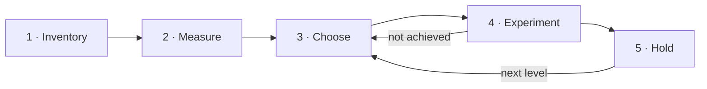

# Onhundred Protocol v1.0

A method for delegating your life and work to AI agents.

Oct 9, 2026 · Reference application: Ale Sánchez · Pending external review

## Warning

This protocol hands parts of your life and your work to AI agents. It can strain your relationships, disrupt your company and expose your data. Nobody knows how it ends, because nobody has finished it yet.

**Don't start if you can't stop the moment someone you love asks you to.**

If it works, you get back the hours, the money and the attention you spend on everything a machine can do for you.

**Delegate agency.**

## How it works

**The goal:** delegate to AI agents everything you do that can be delegated safely, and prove each step with numbers.

You split your life (or your job) into exactly 100 recurring responsibilities, called loops. Then, a few at a time, you hand each one to an AI agent, and it stays there only if the evidence shows it works.

1. **Inventory.** An agent reads your recent history and proposes your 100 loops, each with a rough estimate of what it costs you. You approve the list.
2. **Measure.** Before touching a loop, you watch it happen 3 times to record what it really costs: time, money and quality. That is its baseline.
3. **Choose.** You work on 3 loops at a time: one easy, one hard, and one fun.
4. **Experiment.** For each loop, you write down a question, your bet and how you'll know the agent succeeded, then you try.
5. **Hold.** If it works, it has to keep working for 3 more weeks before the loop officially moves up a level. Then the same experiment can climb to the next level.

Everything runs in two-week cycles. Every cycle you correct the list, close what finished and record what happened in the log.

**Three rules that never bend:**

- Success is defined before each stage of an experiment starts, and never changed afterward.
- Failures are recorded with the same weight as successes.
- Nobody else is affected by a delegation without knowing and agreeing to it.

The rest of this document is the detailed rulebook. Every number in it is collected in the Parameters table (section 16). Terms are defined where they first appear and collected in the Glossary at the end.

## 1. Purpose

It's easy to say AI will change your work. It's harder to say which loops, by how much and at what cost. This protocol answers that one loop at a time, and keeps the receipts.

**Objectives:**

1. Map everything a person does, at home and at work, in 100 loops.
2. Delegate to AI agents every loop that can be delegated safely, one level at a time.
3. Measure the time and money each delegation frees, and what it costs.
4. Document the process, costs and failures in enough detail for anyone to apply it.

**Reference application:** Ale Sánchez, co-founder and CTO of 4Geeks, runs this protocol on his own life and publishes every result at onhundred.com, so others can see the method working, and failing, on a real case.

This protocol is written before the results. Its rules are not changed to make the results look better.

## 2. Who and what it covers

A life is too big to delegate as one thing. The protocol cuts it into branches and areas, so a company can use one branch without ever seeing the others.

### 2.1 Branches

The protocol covers a person's whole life, organized in three **branches**. Each application chooses which branches it activates.

| Branch | What it covers | Who activates it |
| --- | --- | --- |
| C · Company | The person's work: the responsibilities of their role | Individuals and companies |
| P · Personal | Finances, home, income, routines and health at the level of systems | Individuals only |
| R · Relationships | The logistics around the people who matter to them | Individuals only |

### 2.2 Applications

An **application** is one person running the protocol. That person is the **owner**: the loops being delegated are theirs.

- **Individual:** the owner activates all three branches. The reference application is individual.
- **Organizational:** a company applies the protocol to each participating employee, activating only branch C. Branches P and R do not exist for the company; if an employee wants to use them, they belong to the employee alone, with no company access.

### 2.3 Out of scope in any application

- Other people's responsibilities. The protocol delegates what the owner does, not the people around them.
- Applying the protocol to minors, in any form.
- Clinical data or health diagnoses.
- Irreversible legal or financial decisions without the owner's explicit approval at the time.
- The activities of anyone who has not given consent.

### 2.4 Areas and codes

Each branch is divided into **areas**, and every loop has a **code** in the format BRANCH-AREA-NN (for example, C-SAL-04, "follow up with leads"). The code makes it possible to activate whole branches, compare the same area across employees, and apply rules by area without reviewing loop by loop.

| Branch | Base areas (code) |
| --- | --- |
| C · Company | Sales (SAL), Marketing (MKT), Support (SUP), Finance (FIN), Operations (OPS), Product (PRD), People (PPL), Leadership (LDR) |
| P · Personal | Finance (FIN), Home (HOM), Health (HLT), Income (INC), Administration (ADM) |
| R · Relationships | Partner (PAR), Children (KID), Family (FAM), Friends (FRN), Professional network (NET) |

**Rules:**

- Base areas are shared across all applications, so results are comparable.
- A company can add areas specific to its industry (for example, C-EDU for education), but cannot rename the base areas.
- A loop belongs to a single area. If it fits in two, it is split into two loops.
- A retired code is never reused, so every code keeps a single history.
- Consent rules and ceilings are assigned by branch or by area, and every loop inherits them from its code.

## 3. Loops and their levels

Exactly 100 loops, five levels, three flags. The number is fixed on purpose: without a limit, the list only grows.

### 3.1 The 100 loops

A **loop** is a recurring responsibility of the owner, specific enough to be delegated: following up after sales calls (C-SAL-04), deciding what's for dinner (P-HOM-03), answering the school group chat (R-KID-02). The list of all 100 is the **inventory**. It's called a loop because it keeps coming back until someone closes it, and an open one keeps taking up space in your head.

- There are always exactly 100 loops. A new loop forces merging two existing ones or retiring a less important one.
- The split across branches and areas comes out of the inventory and can change every cycle.
- A loop keeps its level across cycles unless a correction splits, merges or retires it. A split loop's new loops start at mapped if the measured baseline still applies, and at unmapped if not.

### 3.2 Levels

Every loop sits on one track of five **levels**:

| Level | Meaning | Who decides | Who acts |
| --- | --- | --- | --- |
| Unmapped | In the inventory, but not yet measured | The owner | The owner |
| Mapped | Measured: we know what it costs today | The owner | The owner |
| Assisted | Proven at this level | The owner, with the agent's recommendation | The owner |
| Delegated | Proven at this level | The agent proposes, the owner approves | The agent |
| Autonomous | Proven at this level | The agent | The agent; the owner reviews results |

### 3.3 Flags

While a loop is being worked on, it carries one flag on top of its level. A loop without a flag is idle.

| Flag | Applies to | Meaning |
| --- | --- | --- |
| Measuring | Unmapped loops | Its baseline is being recorded (section 6) |
| Experimenting | Mapped loops and above | A stage of an experiment is trying to move it up a level (section 8) |
| Holding | Mapped loops and above | A stage succeeded; the loop must keep passing before its level changes (section 9) |

Flags never change a level. Only the end of a holding period, or a drop (section 9.2), does.

## 4. The cycle

Two weeks is long enough to see results and short enough to change course. Every cycle ends by reviewing the method itself, not just the results.

Each application moves in **cycles** of two weeks, numbered consecutively. Each cycle has three moments:

1. **Map.** Correct the inventory (add, split, merge or retire loops), recalculate triage and fill open slots.
2. **Delegate.** Run the active measurements and experiments.
3. **Review.** Close stages that reached their deadline, record the cycle's changes in the log and hold a retrospective on the method itself.

A loop can take several cycles to move up. The cycle is the rhythm of review and reporting, not the deadline for any single loop.

**Work-in-progress limits.** The owner's attention, not the number of open threads, sets the pace:

- At most **3 experiments** at once, one per slot type (section 7). An experiment keeps its slot until it concludes.
- At most **5 loops with the Measuring flag**. Measuring is mostly passive, so it can run further ahead.

## 5. Step 1 · Build the inventory

Calendar, email and documents already describe most of a life. The question for this step: **can an agent read them well enough to map it?**

### 5.1 Procedure

1. **History.** An agent reviews the last 90 days of existing records (calendar, email and Drive metadata and summaries, section 10) to find recurring responsibilities.
2. **Sample week.** For one week, the owner runs the computer tracker and the wearable and adds voice notes, to cover what history does not show.
3. **Proposal.** The agent groups the activity into 100 loops, assigns each its code, and **estimates** its time, frequency and cost.
4. **Coverage check.** The proposed loops must explain at least 70% of the owner's waking hours in the sample week. Gaps are documented and filled with voice notes.
5. **Review.** The owner confirms, merges, splits or rejects each proposed loop. No loop enters the inventory without their approval.
6. **Close.** The inventory is frozen as version 1, with every loop at unmapped. Building it should take no more than one cycle.

### 5.2 Triage

Every loop gets a **triage** score from 1 to 5 on five criteria:

| Criterion | Question | Effect |
| --- | --- | --- |
| Time | How many hours per week does it take? | Adds |
| Frequency | How often does it repeat? | Adds |
| Clear rules | How well defined is the way it's done? | Adds |
| Digital data | Does the information already live in systems? | Adds |
| Error risk | What happens if the agent gets it wrong? | Subtracts |

**Score** = Time + Frequency + Clear rules + Digital data − Error risk, with all criteria weighing the same.

The score is calculated in code: from the estimate while a loop is unmapped, and from its measured baseline afterward. Every recorded score says which of the two it comes from.

**Groups:**

- **Automate now:** score of 13 or more and error risk of 2 or less.
- **Not yet:** error risk of 4 or more, or a loop already at its ceiling.
- **Later:** every other loop.

In an organizational application, triage aggregated by area is the initial diagnostic: it shows which areas of the company hold the best-scoring loops.

### 5.3 Success and what gets recorded

**Success criterion:** at least 60% of the loops in version 1 were proposed by the agent without major correction by the owner.

**Ongoing accuracy:** every later correction to a loop the inventory got wrong (a split, a merge, a retirement, an estimate off by more than half) is counted and recorded each cycle, as part of the answer to this step's question.

**Recorded:** the inventory, which loops the agent proposed correctly, which ones it missed and which it could not have known about.

## 6. Step 2 · Measure a loop

Nobody can prove an agent saved time without knowing how much time the loop took before. A loop's **baseline** is that number, measured before any agent touches it. It is measured only when the loop gets the Measuring flag, not before.

**Which loops get measured.** Measuring slots are filled from the unmapped loops by estimated triage, always keeping at least one easy candidate and one hard candidate (section 7) in measurement, so an experiment slot never waits for a baseline.

**How long.** Measurement runs until the loop has been observed 3 times. Each instance of a loop being done is an **occurrence**. Why 3: one occurrence is an anecdote, two can be a coincidence, three is a pattern worth testing against. A daily loop is measured in days; a monthly loop needs months. Slow loops measure in the background while faster ones move ahead.

**Time cap.** If a loop has not occurred 3 times in 90 days, its baseline is taken from the occurrences observed and recorded as low-confidence. A loop observed zero times in 90 days is reviewed in the next Map: it may not be recurring, and can be retired or merged.

**What is recorded:**

- **Time:** how long each occurrence takes.
- **Frequency:** how often it actually happens.
- **Money:** anything spent doing it.
- **Quality,** where it applies: a measure the experiment can later compare against (reply rate for lead follow-ups, zero late payments for bills).

**Scope.** Measurement is limited to what the loop needs. Measuring one loop is not a reason to record more than that loop's activity.

**Approval.** The owner approves the measured baseline, the loop moves from unmapped to mapped, and its triage is recalculated with real data.

## 7. Step 3 · Choose what to work on

One loop likely to win, one likely to lose, and one chosen for the fun of it. The protocol works all three in parallel and declares the rule in advance, so the choice is part of the method rather than a hidden bias.

There are three experiment **slots**, each with a type:

| Slot | Which loop enters | Purpose |
| --- | --- | --- |
| Easy | The idle loop with the highest score in the Automate now group | An early, likely win that keeps the pace |
| Hard | The idle loop with the highest Time score among those with Clear rules or Digital data of 2 or less, outside the Not yet group | A valuable loop that needs research, longer measurement or solving blockers |
| Fun | Any idle loop outside the Not yet group that the owner enjoys: something silly they would love to automate (deciding dinner counts), or something they are passionate about | Keeps the owner engaged |

Only loops at mapped or above can fill a slot.

**Rules:**

- Easy and hard slots are filled in code from the triage, so the owner can't quietly pick only the loops they already like. Ties are broken by code order.
- The fun slot always records the reason for the choice.
- If no loop is eligible for a slot, it stays empty and that is recorded.

**Expected curve.** Before Cycle 1, the owner records the expected shape of the main metric over time. Because easy loops enter first, delegation is expected to rise quickly and then slow down. Results are always reported by slot type, so the early rise is not mistaken for the long-term trend.

## 8. Step 4 · Run an experiment

An **experiment** is a question nobody can answer yet, a bet that can lose, and up to three **stages** to find out. Everything is written down before it starts, so nobody, including the owner, can move the goalposts. Experiments are what people follow, so how they are phrased and published matters as much as how they are run.

### 8.1 The experiment card

The card is registered in the log before the first stage starts. After that, it only grows: stages are added, nothing is rewritten.

| Field | Content |
| --- | --- |
| Code | EXP-NN |
| Question | What the experiment answers, in one sentence anyone understands (for example, "Can an agent sell on a voice call, even when the buyer knows it's an agent?") |
| Hypothesis | The owner's bet, written as If, then, because (for example, "If an AI voice agent, introduced as an AI, runs first sales calls with leads who agreed to it, then it will close less than half as many sales as I do, because buyers don't connect with an agent.") |
| Loops | Which loops it tries to move |
| Slot | Easy, hard or fun; for fun, the reason for the choice |
| Starting level and goal | The loops' level today, and the highest level the experiment aims for, within the ceiling |
| Baseline | The measured baseline of each loop, with its confidence |
| People involved | Who, and proof of their consent |

**A good question** is one sentence, answerable, about something people care about, and free of jargon. **A good hypothesis** names the approach, the expected result and the reason, so the outcome can prove it wrong.

### 8.2 Stages

An experiment climbs one level per stage, with up to three stages: assisted, delegated and autonomous. Each stage is registered before it starts and never changed once it starts.

| Field | Content |
| --- | --- |
| Stage | 1, 2 or 3, and the level it aims for |
| Approach | What the agent will do, with which tools, and how it fits into the owner's work |
| Why this approach | Why it should work, and what earlier stages taught |
| Success tests | The evals that decide whether the stage worked, with a numeric threshold where applicable |
| Stop early if | The condition that ends the stage immediately |
| Dates | Start date and deadline |
| Expected cost | Tools and estimated AI cost |
| Risks | What could go wrong and how it would be detected |

A stage can be registered when the experiment starts or after the previous stage ends, so each stage can use what the last one taught. The approach never changes in the middle of a stage: the stage is closed as terminated and a new try of the same stage is registered.

### 8.3 Closing a stage

Every stage closes with one of three outcomes:

- **Achieved:** the success tests passed. The loop gets the Holding flag (section 9).
- **Not achieved:** the deadline arrived without passing. The owner registers a new try of the stage, or concludes the experiment.
- **Terminated:** the stage was stopped early, with the reason. Same options as not achieved.

Every outcome is recorded with the actual cost and what was learned.

### 8.4 Concluding the experiment

An experiment concludes when it reaches its goal level, when the owner decides to stop climbing, or when the loop drops back to mapped (section 9.2). At conclusion, the owner records the final level reached and whether the hypothesis was confirmed, refuted or unclear. A refuted hypothesis is a result, not a failure.

## 9. Step 5 · Hold the level

Passing once proves an agent can do it. Passing for 3 weeks proves it does. **A running stage never changes a loop's level;** only a completed hold does.

### 9.1 Moving up

A loop moves up one level when:

1. Its current stage closed as achieved.
2. It kept passing that stage's success tests for 3 consecutive weeks while holding: long enough to include a bad week, short enough to keep moving.
3. It did not require emergency interventions by the owner in that period, other than those expected at its level.
4. Its AI cost is lower than the value of the time or money it frees, or there is a documented justification if not.
5. The new level does not exceed the loop's ceiling.

If any condition fails, the Holding flag is removed and the level stays where it was. Once the loop moves up, the experiment's next stage can start.

### 9.2 Moving down

| Cause | Effect |
| --- | --- |
| Fails its evals for 5 consecutive days | Drops one level |
| Causes real harm to a person, to the owner's money or to the company | Drops immediately to mapped |
| Loses the consent of anyone involved | Drops immediately to mapped |

Every drop is recorded with its cause. A loop's status always reflects its most recent stage, so a later failure is never hidden behind an earlier success.

### 9.3 Ceilings

A **ceiling** is the maximum level allowed for an area, even if it could technically go higher.

| Code | Ceiling |
| --- | --- |
| R-KID · Children | Assisted |
| R-PAR · Partner | Delegated, only with their consent and a stop button |
| P-HLT · Health | Assisted |
| P-FIN · Decisions over $500 | Delegated |
| C-PPL · Decisions about people (hiring, evaluating, firing) | Assisted |

Ceilings are enforced in code: no loop can be recorded above its ceiling. In branch C, a company can set stricter ceilings by area, never more permissive than these.

## 10. What gets recorded, and what never does

The protocol needs data about the owner's life. It never needs anyone else's. Every rule below follows from that.

**Sources:**

| Source | What it captures | Restriction |
| --- | --- | --- |
| Local computer tracker (for example, Screenpipe) | Apps, documents, sites and meetings | Screen only, processed locally |
| Wearable device (for example, Omi or Plaud NotePin) | Activity away from the desk | Off at home; muted by geofence if always-on |
| Calendar, email and Drive, including the last 90 days of history | Meetings and recurring responsibilities | Metadata and summaries only, no third-party content |
| Owner's voice notes | What leaves no digital trace | The owner's voice only |

**Recording rules:**

- The owner may record themselves. They do not record other people without consent. Many jurisdictions, including Florida, require the consent of all parties to record a conversation.
- Work calls and meetings are recorded only with the standard recording notice at the start.
- The home is not recorded.

**Retention and deletion:**

- The agent extracts what the owner did, not what others said.
- Raw audio is deleted automatically after being summarized, within 7 days at most. The rule is enforced in code, not by hand.
- Summaries are kept for the duration of the application and can be deleted at the request of anyone mentioned in them.

**Security:** raw data and summaries live on storage controlled by the owner, encrypted, with no third-party access. Any processing by an outside AI provider is limited to what a loop needs and is disclosed on the experiment card.

## 11. Metrics

Three numbers, all calculated in code, none typed by hand: how much is delegated, how much time it freed and what it cost.

| Metric | Formula |
| --- | --- |
| Delegated (main metric) | Loops at delegated or autonomous level / 100 |
| Time freed | Hours per week no longer spent by the owner, against each loop's baseline |
| Net savings | Money saved and earned by delegated loops, minus AI and tool costs |

By branch or area, each metric is calculated the same way over that branch's or area's loops. All of them are also reported by slot type. In organizational applications they are reported by area in the **aggregate grid** (the sum of all participants' loops, grouped by area), never by individual employee.

**Integrity rules:**

- Every metric is calculated in code from its sources: the inventory, agent logs, AI billing, receipts and documents. None is entered by hand.
- Every metric records its formula and its last-updated date.
- The code that calculates the metrics, and the Parameters table it reads from, are open and live with the protocol at delegate.onhundred.com.
- Estimated and measured figures are always labeled as such.
- Savings are backed by a verifiable document (policy, contract, statement), with sensitive data hidden.
- Money earned only counts if it comes directly from something delegated.
- If a calculation error is found, it is corrected and the correction is recorded; previous values are not erased from the history.

## 12. Ethics and consent

**Principle:** the protocol delegates what the owner does. Nobody else is affected by a delegation without knowing and agreeing to it.

| Person | Rule |
| --- | --- |
| Partner | Knows the protocol is running, approves anything published about them and can stop any loop that involves them at any time. May not know which specific message was assisted, but does know the protocol is running. |
| Children | The protocol is never applied to them. Only the owner's logistics for being with them are automated. They never appear in any record with their face or identifiable data. |
| Family and friends | Informed before appearing in any publication, and can ask not to appear. |
| Employees and team | Participation is voluntary and does not affect their job. Consent is never requested as a condition. |
| Students, leads and clients | Interactions are recorded only with the standard notice. No identifiable data is published. |
| Companies in published case studies | Sign a publication agreement before starting. |

**Loop names** never include a person's name or identifying detail. Loops in R-PAR are published only with the partner's approval.

**Stop button:** anyone involved can ask to stop whatever involves them. The affected loop drops to mapped immediately, with no justification required.

**Health:** systems are shared (routines, reminders), never clinical data.

### 12.1 Rules for organizational applications

Every loop with a C code inherits these rules when a company applies the protocol to its employees. The company signs them before starting.

1. **Purpose limitation.** The inventory, the triage and the results are not used to evaluate performance, decide layoffs or set compensation.
2. **Commitment on freed-up time.** Before starting, the company states in writing what happens to recovered hours (new projects, training, less overtime or another use) and communicates it to participants.
3. **Voluntary participation.** No employee is required to participate, and not participating has no consequences. Where collective representation exists, the agreement is negotiated with it.
4. **Data ownership.** Raw data belongs to the employee. The company sees the aggregate grid by area and the experiment results, not individual minute-by-minute activity.
5. **Minimum aggregation.** The aggregate grid is only shown for areas with at least 5 participants, so no one is identifiable.
6. **Branches P and R closed.** The company has no access to any employee's Personal and Relationships branches, not even to know whether they use them.
7. **Own pace.** Each employee has their own slots and limits. The company cannot fill an employee's fun slot.
8. **Legal compliance by jurisdiction.** Before starting, the legal annex for each region with participants is reviewed (monitoring notices in the US, GDPR and works councils in Europe, local regulations in Latin America).

**Roles:**

| Role | Responsibility |
| --- | --- |
| Executive sponsor | Signs the rules and the commitment on freed-up time |
| Protocol coordinator | Runs the cycles, maintains the log and reports internal results |
| Participating employee | Owns their application, validates their inventory, takes part in experiments and can withdraw at any time |
| Reviewer | Someone outside the participants' chain of command who audits compliance with these rules |

## 13. Reporting

Every application keeps a **log**: its inventory, experiments, outcomes and changes. What the log shows the world depends on who is running it.

| Application | Who sees the log |
| --- | --- |
| Reference application | Everyone. It is published at onhundred.com, with agents, prompts and workflows at delegate.onhundred.com |
| Individual | The owner. Publishing it is the owner's choice |
| Organizational | The participating employee, and the protocol coordinator by area under section 12.1 |

**What the log contains:**

- The grid (the visual representation of the 100 loops), updated from its sources.
- The expected curve, before Cycle 1.
- Each experiment: its card before the first stage, each stage before it starts, and every outcome.
- A weekly entry: what was delegated, what failed and what's left.
- Each cycle's changes: loops added, retired, split and merged, flag and level changes, and the inventory accuracy count.
- The agents, prompts and workflows used.

**Publishing an experiment.** Each experiment gets one page, in this order: the question, the owner's bet, the stages with their status, results against the success tests, and what surprised the owner. Refuted bets and terminated stages are published with the same weight as the rest.

**Rules for every log, private or public:**

- Failures carry the same weight as successes.
- No figure is recorded unless it can be verified.
- Third-party data is anonymized before anything is published.

**Reference application only:** 4Geeks figures are published only with the business partners' agreement (section 17), and published case studies with companies follow the agreement signed with each one, including how a failed result is published.

## 14. When to stop

No hours saved are worth a relationship, a company or a person's health. The whole application is paused, not just one experiment, if any of these happens:

1. **Relationships:** the partner or a close family member asks to stop it, or the owner sees that the protocol is harming a relationship.
2. **Health:** for 2 consecutive weeks, the owner works more hours than their average weekly work hours in the 90-day history used to build the inventory, or a health professional recommends pausing.
3. **Company:** an automation causes material harm to the company or its clients.
4. **Legal:** any reasonable doubt about the legality of a capture or publication, until it is resolved with a lawyer.
5. **Data:** a leak or unauthorized access to the application's data.

**When paused:** the pause and its reason are recorded in the log, with as much detail as the situation allows. The application resumes only once the cause is resolved and the change is documented.

## 15. Conflict of interest and changes

The person running the reference application also sells AI training. This section is how that interest is kept away from the results, and how the protocol itself is allowed to change.

### 15.1 Conflict of interest in the reference application

The owner of the reference application is a co-founder and shareholder of 4Geeks, which offers AI training and automation services for companies. Onhundred is also a channel through which 4Geeks becomes known, and it can generate revenue for 4Geeks through courses, diagnostics and case studies.

To keep that interest from contaminating the results:

- Success tests are defined before each stage and are not changed afterward.
- The rule for choosing which loops to work on is declared in this protocol, and every fun choice is published with its reason.
- Failures are published with the same weight as successes, even when they don't favor 4Geeks.
- Tools are chosen for results, not commercial relationships, and any sponsorship or agreement with a tool is disclosed.
- Onhundred's published content includes no offers; the relationship with 4Geeks is disclosed on the site.

### 15.2 Changes to the protocol

- The protocol is versioned (v1.0, v1.1, v2.0) and every version stays published.
- Every change is recorded in a public changelog with its date, what changed and why.
- Changes apply from the next cycle. The success tests of a stage that has already started are never changed.
- Changes that relax an ethics, consent or ceiling rule require external review before taking effect.
- At the close of each cycle, the protocol is reviewed for needed changes, including triage weights and the Parameters table.

## 16. Parameters

Every number in the protocol lives here. The metrics code reads its values from this table, published as a configuration file. The last column says whether an application (an individual or a company) can change a value.

| Parameter | Value | What it controls | Section | Can an application change it? |
| --- | --- | --- | --- | --- |
| Cycle length | 2 weeks | Rhythm of review and reporting | 4 | Yes |
| Experiment slots | 3 (easy, hard, fun) | Experiments running at once | 4, 7 | The number, yes; the three types, no |
| Measuring slots | 5 | Loops being measured at once | 4, 6 | Yes |
| History lookback | 90 days | Records reviewed to build the inventory | 5 | Yes |
| Sample week | 1 week | Live capture to fill gaps in history | 5 | Longer only |
| Coverage | 70% of waking hours | Minimum the inventory must explain | 5 | Higher only |
| Inventory success | 60% of loops | Agent proposals accepted without major correction | 5 | No, for comparability |
| Triage groups | Automate now: score 13+ and risk 2 or less. Not yet: risk 4+ | How loops are grouped | 5.2 | No, for comparability |
| Triage weights | All equal | How much each criterion counts | 5.2 | Reviewed each cycle |
| Hard slot eligibility | Clear rules or Digital data 2 or less | Which loops count as hard | 7 | No, for comparability |
| Occurrences to measure | 3 | Observations needed for a baseline | 6 | Higher only |
| Measuring time cap | 90 days | Longest a loop can be measured | 6 | Yes |
| Holding period | 3 consecutive weeks | Sustained success before moving up | 9.1 | Longer only |
| Failure days | 5 consecutive days | Failures before dropping a level | 9.2 | Fewer only |
| Financial ceiling | $500 | Decisions above it can't be autonomous | 9.3 | Lower only; individuals only |
| Raw audio deletion | 7 days | Longest raw audio can exist | 10 | Shorter only |
| Minimum participants | 5 per area | Smallest area shown in the aggregate grid | 12.1 | Higher only |
| Health stop | 2 consecutive weeks | Weeks of extra work hours before pausing | 14 | Fewer only |

Ceilings by area (section 9.3) follow the same logic: an application can only make them stricter.

## 17. Open items

These items are not decided by one person alone. Until each is resolved, the rule in the last column applies.

| Item | What is needed | Until resolved |
| --- | --- | --- |
| External review | A reviewer with research experience reviews this protocol | The protocol is published as pending external review |
| Legal review | A lawyer reviews the capture and publication rules | Only the owner's own voice and screen are captured outside recorded work meetings |
| Legal annexes by region | Annexes for the US, Latin America and Europe | No organizational application starts in a region without its annex |
| Company figures | Agreement with the 4Geeks business partners on which figures the reference application shares | No 4Geeks figure is published |
| Final base areas | Confirmation of the base area list after the first inventory | The areas in section 2.4 apply |

## Glossary

| Term | Definition |
| --- | --- |
| Aggregate grid | The sum of several owners' loops, grouped by area. Only in organizational applications. |
| Application | One person running the protocol, alone or as part of a company. |
| Area | A group of loops within a branch, such as Sales within Company. |
| Baseline | The measured time, frequency, money and quality of a loop over its first occurrences, before any intervention. |
| Branch | C (Company), P (Personal) or R (Relationships). |
| Ceiling | The maximum level allowed for an area. |
| Code | A loop's identifier, in the format BRANCH-AREA-NN. |
| Cycle | A two-week period of Map, Delegate and Review. |
| Estimate | A loop's approximate time, frequency and cost, inferred from existing records before measurement. |
| Eval | A success test, defined before a stage starts, that decides whether it worked. |
| Experiment | The story of handing a loop to an agent: a question, the owner's bet and up to three stages (EXP-01 onward). |
| Flag | A temporary mark on a loop being worked on: Measuring, Experimenting or Holding. |
| Grid | The visual representation of the 100 loops. |
| Holding period | The weeks a loop must keep passing its success tests after an achieved stage before its level changes. |
| Hypothesis | The owner's bet about an experiment, written as If, then, because. |
| Idle | A loop with no flag. |
| Inventory | The list of the owner's 100 loops, versioned every cycle. |
| Level | A loop's degree of delegation: unmapped, mapped, assisted, delegated or autonomous. |
| Log | An application's record: inventory, pre-registrations, outcomes and changes. |
| Loop | A recurring responsibility of the owner, specific enough to be delegated. |
| Occurrence | One instance of a loop being done. |
| Owner | The person whose life or role is being delegated. |
| Reference application | Ale Sánchez's public application of the protocol, published at onhundred.com. |
| Slot | One of the three places for a running experiment: easy, hard or fun. |
| Stage | One level of an experiment, with its own approach and success tests. |
| Triage | The score that ranks which loops to work on first. |

## Changelog

**v1.0 · Oct 9, 2026.** First published version. Changes from the Oct 5 draft:

- Rewrote every section opener to say why the section exists, added a one-line reason next to the key numbers (100 loops, 3 occurrences, 3-week hold), and renamed sections 10 and 14 in plain words, following VOICE.md.
- Reframed the protocol as a method for delegating life and work to AI agents. Ale Sánchez's public project at onhundred.com is now its reference application.
- Renamed the subject to the owner and parts to loops, and replaced public publication with a log: public for the reference application, private or internal for any other.
- Made delegated loops, time freed and net savings the metrics.
- Added "How it works", a one-page summary of the five steps and the three rules that never bend.
- Reorganized the rulebook around the five steps: inventory, measure, choose, experiment, hold.
- Replaced the upfront Phase 0 with a fast inventory built from existing history plus one sample week, and a baseline measured per loop, by occurrences (3) with a 90-day cap.
- Merged the separate stage track into the levels: one track of five levels, plus three temporary flags (Measuring, Experimenting, Holding).
- Added fixed two-week cycles and work-in-progress limits (3 experiment slots, 5 measuring slots).
- Added typed slots (easy, hard, fun), the selection rules and the expected curve.
- Gave experiments a question, a hypothesis and up to three stages, one per level, so one experiment tells the whole story of a loop.
- Made explicit that a running stage never changes a level, added the holding period and the three close outcomes, and made a loop's status follow its most recent experiment.
- Defined triage group thresholds and labeled scores as estimated or measured.
- Collected every number in a Parameters table, published as the configuration the metrics code reads, with what each application may change.
- Codes are never reused, ceilings are enforced in code, and loop names carry no identifying detail.
- Moved definitions to a glossary at the end and non-numeric pending items to Open items, each with the rule that applies until it is resolved.
